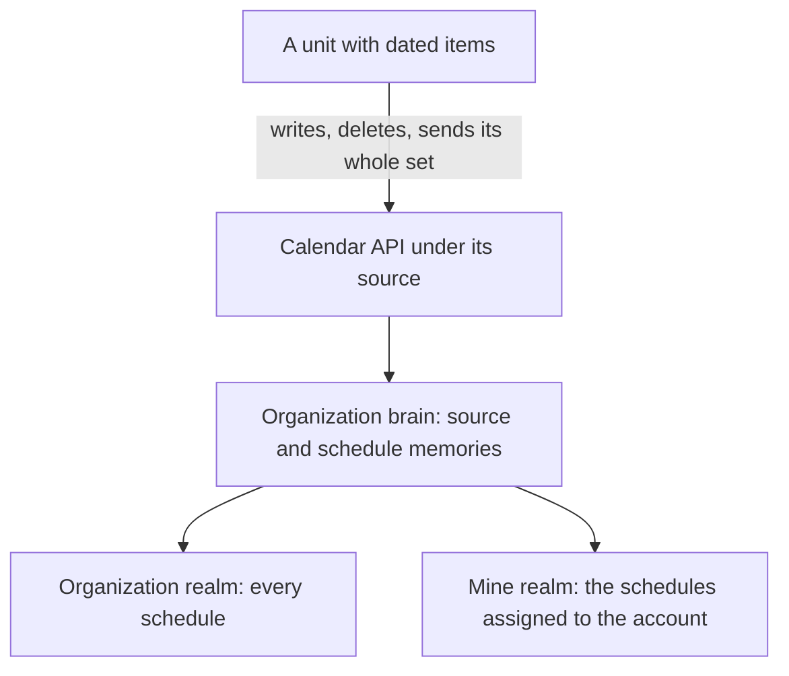

# bmo-calendar

The calendar unit keeps the platform's dated events — appointments, deadlines, anything with a day and a
time — and tells the supervisor when one is due. It is a view and an alarm over the brain: **the brain is
the master and the calendar is the subordinate** (the owner's words: 「캘린더는 비모의 브레인 API를 사용한다.
주가 브레인. 종이 캘린더」). Every calendar and every event is a memory in the brain service; the calendar
unit keeps no truth of its own, only what can be rebuilt from the brain: a cache of what it last read and
the marks of which alarms it has already told.

## Two realms, kept apart

The owner's words: 「일정은 조직 공유가 가능했으면 함」 and 「내 일정과 조직 일정의 분리 필요」.

- **Mine (`mine`):** each console account's own calendars. Only that account reads and writes them; its
  alarms reach that person.
- **Organization (`organization`):** the organization's calendars. Every console account reads them;
  who may write and who is told are settings of each calendar (by default the administrator and the
  event's creator write; the creator is told).

The realms are two kinds of brain in the brain service, never one: an account's realm is the brain keyed
`accountKey = account:<Owner-Key>`, `agentKey = calendar`; the organization's realm is the brain keyed
`accountKey = organization`, `agentKey = calendar`. The calendar unit makes a brain the first time a realm
is written. A screen shows both realms on one grid and tells them apart by colour and a mark; a tool call
names the realm it reads or writes.

## What a calendar and an event are in the brain

- **A calendar** is a memory of type `calendar`: `key` `calendar:<id>`, `text` its name, labels `color`
  (one of the console's six: `primary`, `secondary`, `info`, `success`, `warning`, `error`), `realm`,
  `writers` (organization only: `administrator`, `creator` or `everyone`), `tell` (organization only:
  `creator`, `everyone` or `nobody`), `hidden` (the accounts that hid it from their grid, their Owner-Keys
  joined by commas, empty where none did), `creator` (the account that made it) and `createdAt` (epoch ms,
  the moment its first version was written).
- **An event** is a memory of type `event`: `key` `event:<id>`, `text` its title followed, after a blank
  line, by its description; `validFrom` its start (epoch ms); labels `calendar` (the calendar's id),
  `start` and `end` (local ISO `YYYY-MM-DDTHH:mm:ss`, the shape the console's template uses), `allDay`
  (`true`/`false`), `alarm` (`none`, or minutes before the start: `0`, `5`, `15`, `30`, `60`, `1440`),
  `repeat` (`none`, `daily`, `weekly`, `monthly`, `yearly`), `creator` (the account's Owner-Key), `realm`,
  `createdAt` (epoch ms, the moment its first version was written) and `skip` (the occurrences of a repeating
  event that no longer stand in it, each its local start, joined by commas, empty where none: one cancelled,
  or one changed on its own and so made an event of its own).
- **A source** is a memory of type `source` in the organization realm's brain: `key` `source:<id>`, `text`
  its name, labels `color` (one of the six), `realm` (`organization`), `hiddenOrganization` and `hiddenMine`
  (the accounts that hid its schedules in that realm, their Owner-Keys joined by commas, empty where none
  did) and `createdAt`.
- **A schedule** is a memory of type `schedule` in the organization realm's brain: `key`
  `schedule:<source id>:<item id>`, `text` its title, `validFrom` its start; labels `source`, `item`,
  `start`, `end` and `allDay` (as an event's), `link`, `assignee` (an account's Owner-Key, empty where
  none), `realm` (`organization`) and `createdAt`. A removed schedule is moved to `done`.
- **Local times** are the wall clock of the time zone the calendar unit's host keeps; `validFrom` is the
  start read in that zone. A daily or weekly event repeats on the same wall-clock time; a monthly or yearly
  one on the same day of the month, skipping a month that has no such day.
- A change is a new version of the memory (`POST /memories/{id}/versions`); a cancellation moves the
  memory to `done` with the reason; nothing is deleted. The calendar reads the brain by `type`, the realm
  and `order=validFrom`, pages through, and keeps what it read in its cache, which the brain's event
  stream (`memory.written`, `memory.moved`) refreshes.

## Received schedules

The owner's words: the calendar shows everything the platform's other units hold as schedules and plans,
and knows nothing of those units; they use the calendar's API.

- **A source is data.** A unit pushes its dated items under a source id of its own choosing, each item by
  its own id, with a title, a start and an end, a link to where the item is opened and an assignee where it
  has one. The calendar holds no list of units and no branch for any of them: every source is read,
  written and shown the same way, and a new unit needs nothing of the calendar's but the API.
- **Kept once.** A schedule is kept once, in the organization realm's brain; the brain is its master here as
  for every event. The unit stays the master of the item itself, and the calendar never writes back.
- **Where it stands.** Every schedule stands in the organization realm. One whose assignee is an account
  also stands in that account's own realm, read from the same memory rather than copied into the
  account's brain, so the two realms' brains stay apart.
- **Read-only.** A schedule is changed only by its unit: the screen never moves, stretches, edits or
  cancels one, and a schedule is never told as an alarm.

## Alarms

An event with an alarm is told once, at the moment its alarm comes (start less the minutes). The calendar
unit beats once a minute and reads the due alarms from its cache; the moment it tells one it keeps the mark
`told:<event id>:<occurrence>` (per realm) so a restart tells nothing twice, and a late beat tells what came
due while it was down, once each, naming how late. Beside the marks the store keeps the moment of the last
beat, which is how far back a beat looks; an event written after its alarm's moment and before its start is
told at the next beat. The telling is the receiver's instruction route: an order for the
supervisor in the recipient's room — the owner's private room for the owner; for a member, the room numbered
as one of the senders the account service links to the member's account, where the receiver holds it
registered, and the owner's private room naming the member where it holds none. The order opens on the
marker `CALENDAR ALARM.` and carries the alarm's data alone — the event, its start, its calendar and realm,
how late it is and whom it is for — never an instruction; how a quiet instruction is answered stands in the
receiving session's own rules, so the supervisor says it in its own words (「비모가 알려준다」). A
repeating event's next occurrence is told when its moment comes; a cancelled event's pending alarm is told
no more.

## The tool

The chat supervisor and the owner's tools reach the calendar through the tool host, namespace `bmo`,
capability `room.tools`: list the events of a span, show one, add, change, cancel, and list the calendars,
each naming its realm. The supervisor sets an alarm when the owner asks to be reminded of an appointment.
Every holder of the tool acts for the owner: its `mine` realm is the owner's account, the account the
account service links to the owner's sender.

## The console

The console screen follows the Nuxt UI calendar template (day, week, month and year views, drag to move
and resize, a popover to edit, a quick natural-language entry, colour-coded calendars with visibility, a
mini calendar), stood as a console bundle under the sidebar entry 캘린더 (bmo-ui's console plugin contract;
`docs/api.md`, 「Console」). The sidebar lists 내 일정 and 조직 일정 calendars apart; one grid shows both.

Received schedules stand on the same grid as layers, one for each source in each realm:

- **Layers.** Under each realm's calendars the sidebar lists every source as a layer, by its name and
  colour, marked as received; each is shown or hidden for the reader's account alone, in that realm
  alone, a mark spinning beside it while the change is sent. The 조직 일정 layer of a source carries all
  its schedules, the 내 일정 layer those assigned to the reader.
- **One row each.** Where an item stands in both shown layers, the grid draws it once, as the reader's own.
- **Drawn as an event, read-only.** A schedule is drawn as an event is, in its source's colour with its
  realm's mark and a mark that it is received; it is never dragged, stretched or opened in a form, and a
  held finger opens none of the calendar's menus on it. It is a link: a press, or Enter on it, opens the
  item it stands for, a console path in the console and an address in a new tab.

The screen's own row is its toolbar, directly under the top bar. Nothing but the screen's name and mark
stands beside the title in the top bar, whether the console draws that bar or, on the unit's own app, the
screen draws it. The toolbar holds the steps back and forward, the shown span's title that opens a day
picker, the way to today, the view, while the console is offline the mark that says so, the refresh, and
at its right end a new event. On a phone the way to today stands in a bar at the screen's foot instead,
and the offline mark stands as its icon alone, its words in its tooltip, so the row keeps one line. Every
other button in either bar is the component library's small button at its own size, centred in the row,
its hover and press colours filling only its own shape.

A new event is made from bmo-ui's one create button (`CreateButton`, its components document, 「Creating」),
named 새 일정 and wrapped by the calendar's popover: its first row draws a new event on the day the screen
stands on, and below it the quick entry reads a phrase that names a day and a time. The button's own key,
`n`, presses it, so the key opens the same popover; the calendar binds no key of its own for creating. On
a wide screen the button is the grey icon at the toolbar's right end; on a phone it floats at the screen's
bottom right over the foot bar's right end, and each view's scrolling grid keeps the layer's create room
(`--bmo-create-room`) after its last hour, week or month, so what ends the grid stands clear of it. The add
beside the calendars' group heading is that list's own control and not the screen's create button.

The screen is used by finger and by ear as well as by mouse:

- **Touch.** A finger scrolls the grid and never drags an event. A held finger (the console's one long
  press) on an empty part of the grid draws a new event there, and on an event opens its menu. An event
  is moved by its start in its form, which carries the end along so the event keeps its length; the end
  alone changes its length. On a phone an event's form and a calendar's settings open as a centred
  dialog rather than beside what opened them.
- **Screen readers and keys.** The month view is a grid of days: the weekdays head its columns, each day
  is named by its full date, whether it is today and how many events it holds, and the arrow keys, Home,
  End, Page Up and Page Down walk it, and Enter opens the day. The day and week views name each day the
  same way. Every event is named by its title, its time, its calendar and its repeat, and the span a step
  lands on is said once it has landed.
- **Reading.** The grid's heights follow the reader's text size, so a larger font grows the rows rather
  than cutting their words; the event's calendar colour is a fill and a stripe under words in the page's
  own text colour, so the words read on every colour in both themes. A reader who asked for less movement
  is never scrolled smoothly.
