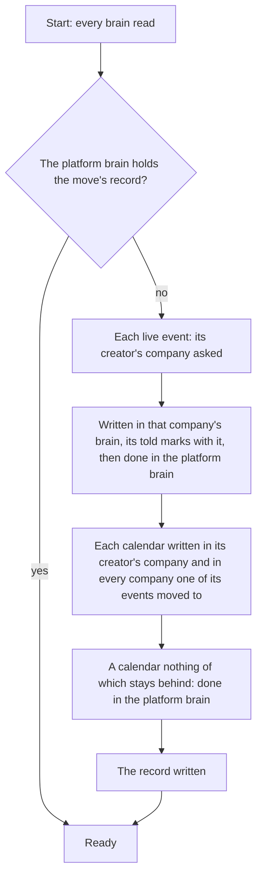
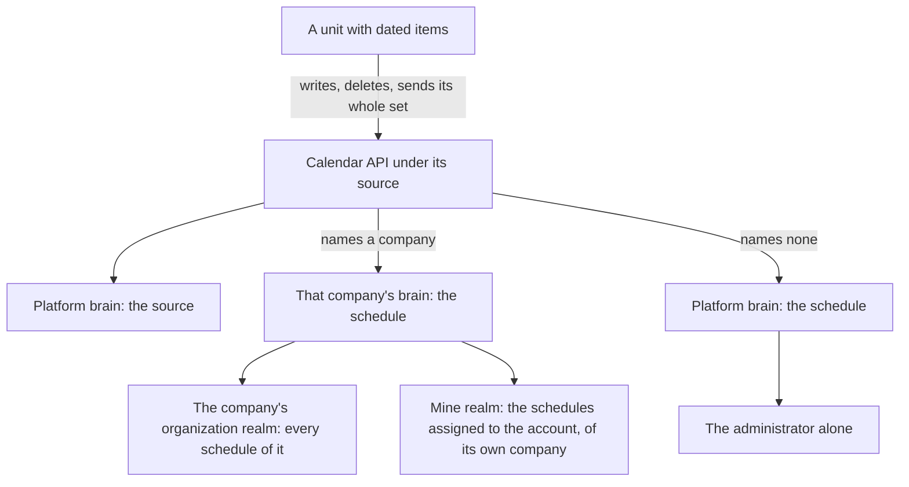

# bmo-calendar

The calendar unit keeps the platform's dated events — appointments, deadlines, anything with a day and a
time — and tells the supervisor when one is due. It is a view and an alarm over the brain: **the brain is
the master and the calendar is the subordinate** (the owner's words: 「캘린더는 비모의 브레인 API를 사용한다.
주가 브레인. 종이 캘린더」). Every calendar and every event is a memory in the brain service; the calendar
unit keeps no truth of its own, only what can be rebuilt from the brain: a cache of what it last read and
the marks of which alarms it has already told.

## Two realms, kept apart

The owner's words: 「일정은 조직 공유가 가능했으면 함」 and 「내 일정과 조직 일정의 분리 필요」. The company is
the unit of isolation (`STRUCTURE.md`, 「Accounts, companies and units」): nothing of one company is read
from another.

- **Mine (`mine`):** each console account's own calendars. Only that account reads and writes them; its
  alarms reach that person.
- **Organization (`organization`):** one for each company: its calendars, the schedules received for it,
  its resources and their bookings. Every account standing in the company reads it, and an account of
  another company reads nothing of it; who may write and who is told are settings of each calendar (by
  default the administrator and the event's creator write; the creator is told).
- **A reader's company** is the company of the unit the account service places the account in
  (`GET /users/{user}/unit`), asked at every call that reaches the organization realm, so a person moved
  to another company reads the new one at once. An account standing in no company reads no company's
  realm and writes none.
- **The platform's own organization realm** holds what belongs to no company: the sources, the schedules
  received with no company, and what the move into companies found no company for (「The move into
  companies」). The platform administrator alone reads it.
- **The platform administrator reads every company's realm,** naming the company; a read that names none is
  the administrator's own company's, as anyone's is.

The realms are kinds of brain in the brain service, never one, each with `agentKey = calendar`: an
account's realm is the brain keyed `accountKey = account:<Owner-Key>`; a company's organization realm the
brain keyed `accountKey = company:<company id>`, the company's unit id as the account service names it; the
platform's own the brain keyed `accountKey = organization`. The calendar unit makes a brain the first time a
realm is written. A screen shows both realms on one grid and tells them apart by colour and a mark; a tool
call names the realm it reads or writes.

## The move into companies

An organization calendar or event standing in the platform's own brain belongs in the brain of a company;
the service moves every such one once, at start, before it answers as ready.

- **Where each goes.** An event goes to the company of its creator; a calendar to the company of its
  creator and to every company one of its events went to, with the same id, name, colour, `writers`,
  `tell` and hidden marks, so every event stands under its calendar. A calendar leaves the platform brain
  once none of its events stays there.
- **What stays.** An event or a calendar whose creator stands in no company, or whose creator is empty,
  stays in the platform's own realm, read by the administrator alone. The received schedules are not
  moved: each unit's next whole set places its schedules in their companies (「Received schedules」).
- **Nothing is lost or told twice.** A moved memory is a first version in the company's brain carrying
  every label and the `validFrom` it had, then the platform's is moved to `done` naming the company it
  went to. The told marks of a moved event are copied to its new brain before the old one closes, so a
  moved alarm is not told again.
- **Once, and recorded in the brain.** The record is a memory of type `migration` in the platform brain, key
  `migration:company-realms`, its labels how many events and calendars moved and how many stayed; the platform
  brain is made for it where none stands, so what the platform's own realm comes to hold later is never moved.
  A start that finds it moves nothing. An account service that does not answer leaves the service not ready,
  and the move is tried again two seconds later from where it stopped: whatever moved is no longer live in the
  platform brain.

## What a calendar and an event are in the brain

- **A calendar** is a memory of type `calendar`: `key` `calendar:<id>`, `text` its name, labels `color`
  (one of the console's six: `primary`, `secondary`, `info`, `success`, `warning`, `error`), `realm`,
  `writers` (organization only: `administrator`, `creator` or `everyone`), `tell` (organization only:
  `creator`, `everyone` or `nobody`), `hidden` (the accounts that hid it from their grid, their Owner-Keys
  joined by commas, empty where none did), `creator` (the account that made it) and `createdAt` (epoch ms,
  the moment its first version was written).
- **An event** is a memory of type `event`: `key` `event:<id>`, `text` its title followed, after a blank
  line, by its description; `validFrom` its start (epoch ms); labels `calendar` (the calendar's id),
  `start` and `end` (local ISO `YYYY-MM-DDTHH:mm:ss`, the shape the console's template uses), `allDay`
  (`true`/`false`), `alarm` (`none`, or minutes before the start: `0`, `5`, `15`, `30`, `60`, `1440`),
  `repeat` (`none`, `daily`, `weekly`, `monthly`, `yearly`), `creator` (the account's Owner-Key), `realm`,
  `createdAt` (epoch ms, the moment its first version was written) and `skip` (the occurrences of a repeating
  event that no longer stand in it, each its local start, joined by commas, empty where none: one cancelled,
  or one changed on its own and so made an event of its own).
- **A source** is a memory of type `source` in the platform's own brain, since a source is a unit's and no
  company's: `key` `source:<id>`, `text` its name, labels `color` (one of the six), `realm`
  (`organization`), `hiddenOrganization` and `hiddenMine` (the accounts that hid its schedules in that
  realm, their Owner-Keys joined by commas, empty where none did) and `createdAt`.
- **A schedule** is a memory of type `schedule` in the brain of the company it names, else in the
  platform's own: `key` `schedule:<source id>:<item id>`, `text` its title, `validFrom` its start; labels
  `source`, `item`, `start`, `end` and `allDay` (as an event's), `link`, `assignee` (an account's
  Owner-Key, empty where none), `realm` (`organization`) and `createdAt`. A removed schedule is moved to
  `done`.
- **A resource** is a memory of type `resource` in its company's brain: `key` `resource:<id>`, `text` its
  name; labels `kind` (the word the company groups it under, such as a meeting room or a reception room),
  `place` (where it stands, in the company's own words), `seats` (a whole number), `approval`
  (`true`/`false`: whether a booking of it waits for a keeper), `keepers` (the accounts that keep it, their
  Owner-Keys joined by commas), `creator` and `createdAt`.
- **A booking** is a memory of type `booking` in its company's brain: `key` `booking:<id>`, `text` its
  title, `validFrom` its start; labels `resource` (the resource's id), `start`, `end`, `allDay`, `repeat`
  and `skip` (as an event's), `booker` (the account's Owner-Key), `state` (`requested`, `booked` or
  `refused`), `decidedBy` and `decidedAt` (the keeper who approved or refused it and when, empty while none
  did), `reason` (the keeper's words with a refusal, empty otherwise), `requestedAt` (when it last came to
  stand requested, empty where it never did) and `createdAt`. A refused booking stands until its booker is
  told, and is then moved to `done`; a cancelled one is moved to `done` with the reason.
- **Local times** are the wall clock of the time zone the calendar unit's host keeps; `validFrom` is the
  start read in that zone. A daily or weekly event repeats on the same wall-clock time; a monthly or yearly
  one on the same day of the month, skipping a month that has no such day.
- A change is a new version of the memory (`POST /memories/{id}/versions`); a cancellation moves the
  memory to `done` with the reason; nothing is deleted. The calendar reads the brain by `type`, the realm
  and `order=validFrom`, pages through, and keeps what it read in its cache, which the brain's event
  stream (`memory.written`, `memory.moved`) refreshes.

## Received schedules

The owner's words: the calendar shows everything the platform's other units hold as schedules and plans,
and knows nothing of those units; they use the calendar's API.

- **A source is data.** A unit pushes its dated items under a source id of its own choosing, each item by
  its own id, with a title, a start and an end, a link to where the item is opened, an assignee where it
  has one and the company it belongs to. The calendar holds no list of units and no branch for any of
  them: every source is read, written and shown the same way, and a new unit needs nothing of the
  calendar's but the API.
- **Kept once.** A schedule is kept once, in the brain of the company it names; the brain is its master here
  as for every event. The unit stays the master of the item itself, and the calendar never writes back. A
  schedule written again naming another company leaves the old company's brain for the new one's.
- **Where it stands.** A schedule stands in its company's organization realm. One whose assignee is an
  account of that company also stands in that account's own realm, read from the same memory rather than
  copied into the account's brain, so the realms' brains stay apart.
- **No company, no reader but the administrator.** A schedule sent with no company stands in the platform's
  own realm alone: no company reads it and no account's own realm shows it, until its unit sends it again
  naming its company.
- **Read-only.** A schedule is changed only by its unit: the screen never moves, stretches, edits or
  cancels one, and a schedule is never told as an alarm.

## Resources and bookings

A company books what it shares by the hour or the day: meeting rooms, reception rooms and the like, by day,
week or month, all day or repeating, some of them only once a keeper approves.

- **A resource is the company's.** It has a name, a kind, a place, its seats, whether a booking of it needs
  approval, and its keepers, accounts of the company. The administrator and a head of the company make,
  change and retire resources; retiring one cancels its standing bookings with it.
- **A booking is an event on a resource:** a title, a start, an end, all day or not, a repeat as an event
  repeats with its skipped occurrences, and its booker. Anyone of the company books, in that company alone;
  the booker and a keeper of the resource change or cancel it, a whole booking or one occurrence of a
  repeating one, which is then a booking of its own as an occurrence of an event is.
- **Never two at once.** Two standing bookings of one resource never overlap: a requested or booked one
  holds its span, a refused one holds none, and a span ends where the next may begin. A write that would
  meet a standing booking is refused, naming the booking it meets. Every write that can make an overlap,
  made by a route or by the tool, runs in this unit under one writer, which checks the cache and writes the
  brain before the next write is checked, so two bookings made at once never both stand. A repeating
  booking is checked occurrence by occurrence over 28 years from the later of the two starts, the span in
  which the weekdays and the days of every month come round again, so a pair that would ever meet meets
  within it.
- **Approval.** On a resource that needs approval a booking made or moved by anyone but a keeper stands
  `requested`; a keeper approves it, and it stands `booked`, or refuses it with a reason. A booking on any
  other resource, or made by a keeper, stands `booked` at once. A change of a booked booking's span, repeat
  or resource by anyone but a keeper makes it `requested` again; a change of its title alone does not.
- **Who is told.** The keepers of the resource are told of a booking that comes to stand requested; the
  booker is told of the approval or the refusal. Each is told as an alarm is told (「Alarms」), once, the
  told mark kept in the store, a telling the receiver does not take tried again at the next beat; a
  refused booking is moved to `done` once its booker has been told.
- **On the calendar's grid.** A booking stands in its booker's own realm as an event of the booker, read
  from the same memory rather than copied into the account's brain, marked with its resource; it is
  opened in the booking's form, never in an event's.

## Alarms

An event with an alarm is told once, at the moment its alarm comes (start less the minutes). The calendar
unit beats once a minute and reads the due alarms from its cache; the moment it tells one it keeps the mark
`told:<event id>:<occurrence>` (per realm) so a restart tells nothing twice, and a late beat tells what came
due while it was down, once each, naming how late. Beside the marks the store keeps the moment of the last
beat, which is how far back a beat looks; an event written after its alarm's moment and before its start is
told at the next beat. The telling is the receiver's instruction route: an order for the
supervisor in the recipient's room — the owner's private room for the owner; for a member, the room numbered
as one of the senders the account service links to the member's account, where the receiver holds it
registered, and the owner's private room naming the member where it holds none. The order opens on the
marker `CALENDAR ALARM.` and carries the alarm's data alone — the event, its start, its calendar and realm,
how late it is and whom it is for — never an instruction; how a quiet instruction is answered stands in the
receiving session's own rules, so the supervisor says it in its own words (「비모가 알려준다」). A
repeating event's next occurrence is told when its moment comes; a cancelled event's pending alarm is told
no more. An organization calendar that tells everyone tells the accounts of its own company; one in the
platform's own realm tells the owner.

## The tool

The chat supervisors and the owner's tools reach the calendar through the tool host, namespace `bmo`,
capability `room.tools`: list the events of a span, show one, add, change, cancel, and list the calendars,
each naming its realm; list the company's resources, find a free one for a span and a number of seats,
book one and cancel a booking. A supervisor sets an alarm when its person asks to be reminded of an
appointment, and books a room when its person asks for one. A holder of the tool acts for the account
agency names as the owner of the agent holding the session, so a supervisor of a person's account reads and
writes that person's own realm and books as that person; a holder agency names no account for acts for the
owner, the account the account service links to the owner's sender. The organization realm and the bookings
of a call are that account's company's.

## The console

The console screen follows the Nuxt UI calendar template (day, week, month and year views, drag to move
and resize, a popover to edit, a quick natural-language entry, colour-coded calendars with visibility, a
mini calendar), stood as a console bundle under the sidebar entry 캘린더 (bmo-ui's console plugin contract;
`docs/api.md`, 「Console」). The sidebar lists 내 일정 and 조직 일정 calendars apart; one grid shows both.
The 조직 일정 are the reader's company's. For the administrator the sidebar's 조직 일정 heading carries a
choice of company, every company and the platform's own among them, the administrator's own company first
chosen; the grid, the layers and the bookings then read the company chosen.

Booking stands on its own screen in the same bundle, 예약, reached from the calendar screen's sidebar and
back again:

- **The resources by day, week and month.** One kind of resource at a time, chosen at the top, its resources
  grouped by place. The day is a row for each resource across the hours, wide enough per hour that an hour's
  booking names its title, scrolled sideways where the hours outrun the screen. The week is a row for each
  resource across its seven days, each day's cell listing that day's bookings by start, each with its time and
  title. The month is a grid of days, each naming how many bookings each resource holds; on a phone, where a
  day's cell has no room for names, how many it holds in all.
- **Booking by press or drag.** In the day view a press on a free span of a resource's row, or a drag across
  one, opens the booking form on that span; in the week view a press on a day's cell opens it on that day's
  first free hour: its title, its start and end, all day, its repeat, and the resource with its seats and
  whether it waits for approval. A span that meets a standing booking is not offered; a refusal of the write
  names the booking it met, by the title the service's refusal gives. On a phone a held finger stands for the
  press, as on the grid. A booking is made in the reader's own company alone: with another company chosen, the
  administrator reads its bookings and is offered no span to book.
- **My bookings.** The reader's own bookings standing from today over the coming year, one row each, by its
  next occurrence: a repeating booking stands once, naming how it repeats and its next date, so its
  occurrences never bury the rest. Each row carries its resource, its state and the way to change or cancel it
  whole; one occurrence is changed or cancelled where it stands on the day or week view or the calendar's
  grid. The year is the reach of the list: the service answers at most 92 days a read, so the screen reads the
  year as four spans, and a booking further ahead is listed once it comes within the year.
- **Requests.** For a keeper, the bookings waiting on the resources they keep, oldest first, each with its
  booker, its span and its resource, approved with one press or refused with a reason.
- **Resources.** The administrator and the company's heads make, change and retire resources from the same
  screen, the screen's one create button adding a resource while this part is shown, choosing the keepers
  among the company's people through the console's people directory. The directory answers the reader's own
  company alone, so the administrator keeping another company's resources names their keepers by their account
  keys.

Received schedules stand on the same grid as layers, one for each source in each realm:

- **Layers.** Under each realm's calendars the sidebar lists every source as a layer, by its name and
  colour, marked as received; each is shown or hidden for the reader's account alone, in that realm
  alone, a mark spinning beside it while the change is sent. The 조직 일정 layer of a source carries all
  its schedules, the 내 일정 layer those assigned to the reader.
- **One row each.** Where an item stands in both shown layers, the grid draws it once, as the reader's own.
- **Drawn as an event, read-only.** A schedule is drawn as an event is, in its source's colour with its
  realm's mark and a mark that it is received; it is never dragged, stretched or opened in a form, and a
  held finger opens none of the calendar's menus on it. It is a link: a press, or Enter on it, opens the
  item it stands for, a console path in the console and an address in a new tab.

The screen's own row is its toolbar, directly under the top bar. Nothing but the screen's name and mark
stands beside the title in the top bar, whether the console draws that bar or, on the unit's own app, the
screen draws it. The toolbar holds the steps back and forward, the shown span's title that opens a day
picker, the way to today, the view, while the console is offline the mark that says so, the refresh, and
at its right end a new event. On a phone the way to today stands in a bar at the screen's foot instead,
and the offline mark stands as its icon alone, its words in its tooltip, so the row keeps one line. Every
other button in either bar is the component library's small button at its own size, centred in the row,
its hover and press colours filling only its own shape.

A new event is made from bmo-ui's one create button (`CreateButton`, its components document, 「Creating」),
named 새 일정 and wrapped by the calendar's popover: its first row draws a new event on the day the screen
stands on, and below it the quick entry reads a phrase that names a day and a time. The button's own key,
`n`, presses it, so the key opens the same popover; the calendar binds no key of its own for creating. On
a wide screen the button is the grey icon at the toolbar's right end; on a phone it floats at the screen's
bottom right over the foot bar's right end, and each view's scrolling grid keeps the layer's create room
(`--bmo-create-room`) after its last hour, week or month, so what ends the grid stands clear of it. The add
beside the calendars' group heading is that list's own control and not the screen's create button.
A new event's ghost follows its form as the form is filled. A date or a time is typed segment by segment,
so the ghost follows it once the focus leaves its segments. A ghost moved to another day is drawn there
again with its form, and the focus stays on the same field of the form drawn there; only the first form
of a new event puts the focus on its title. A new event holds a change while it differs from what it was
drawn as, read through bmo-ui's opened-with snapshot of the draft itself, or while its form holds one the
draft cannot take, such as an end before its start. So the form still asks before a change is thrown
away, wherever it was drawn again, by Esc, by a press outside or by back, one question at a time. Every
form that floats over the screen, an event's, a calendar's settings, a booking's and a resource's, closes
through its open state alone, with its close guard the one refusal, so a focus a menu hands back while it
stands asks nothing.

Every value chosen from a list, the view and the kind in the toolbars among them, is chosen in bmo-ui's
one select (`ChoiceSelect`, its components document, 「Choosing a value」), which alone decides when a list
offers a search; the keepers of a resource are found through the people directory as their names are
typed.

The screen is used by finger and by ear as well as by mouse:

- **Touch.** A finger scrolls the grid and never drags an event. A held finger (the console's one long
  press) on an empty part of the grid draws a new event there, and on an event opens its menu. An event
  is moved by its start in its form, which carries the end along so the event keeps its length; the end
  alone changes its length. On a phone an event's form and a calendar's settings open as a centred
  dialog rather than beside what opened them. Every name the screen shows in a tooltip is bmo-ui's
  shared one (its components document, 「Tooltips」): an icon button is its icon button (`IconButton`)
  and the way to today its shared tooltip standing on a press, so a finger holds either to read its
  name and lifting presses nothing; the offline mark and a schedule source's received mark do nothing
  else, so a tap opens theirs.
- **Screen readers and keys.** The month view is a grid of days: the weekdays head its columns, each day
  is named by its full date, whether it is today and how many events it holds, and the arrow keys, Home,
  End, Page Up and Page Down walk it, and Enter opens the day. The day and week views name each day the
  same way. Every event is named by its title, its time, its calendar and its repeat, and the span a step
  lands on is said once it has landed.
- **Reading.** The grid's heights follow the reader's text size, so a larger font grows the rows rather
  than cutting their words; the event's calendar colour is a fill and a stripe under words in the page's
  own text colour, so the words read on every colour in both themes. A reader who asked for less movement
  is never scrolled smoothly.
